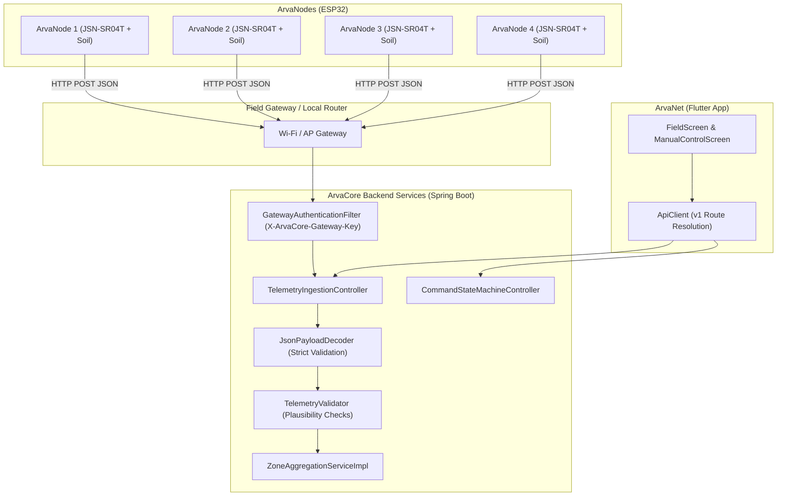

# Design: integrate-arvacore-ecosystem

## Architecture Overview

## Key Invariants
1. **Zero Fabrication**: When telemetry readings are missing or out of valid physical range (e.g. soil moisture < 0% or > 100%, negative distances, ultrasonic distance out of 20–450 cm range), the system rejects or flags them rather than injecting synthetic defaults.
2. **Ultrasonic Still-Well Model**: Distance reading measures sensor-to-float distance inside perforated PVC casing. Water level relative to surface is computed as:
   $$\text{Water Level (cm)} = \text{Sensor Datum Offset (20.0 cm)} - \text{Measured Distance (cm)}$$
3. **Single Point of Control**: Irrigation commands control the central field pump and distribution solenoid valve. Zone endpoints are strictly monitoring observation points.
